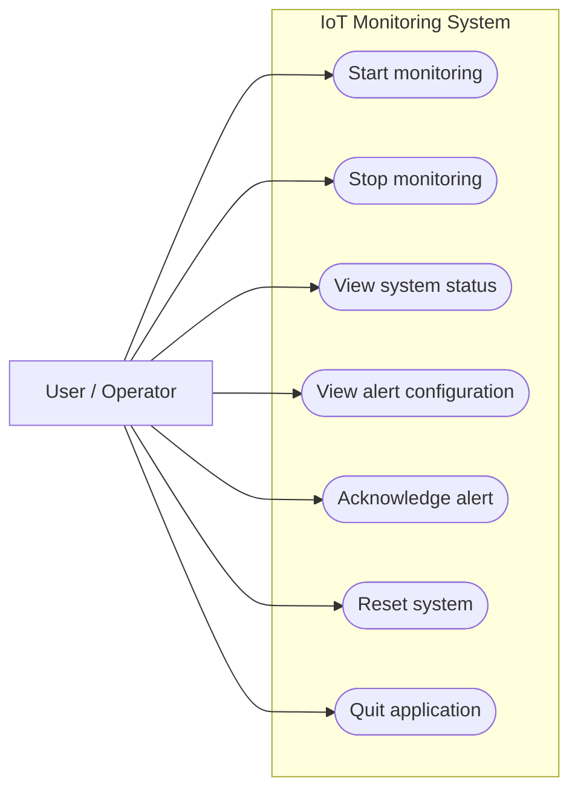
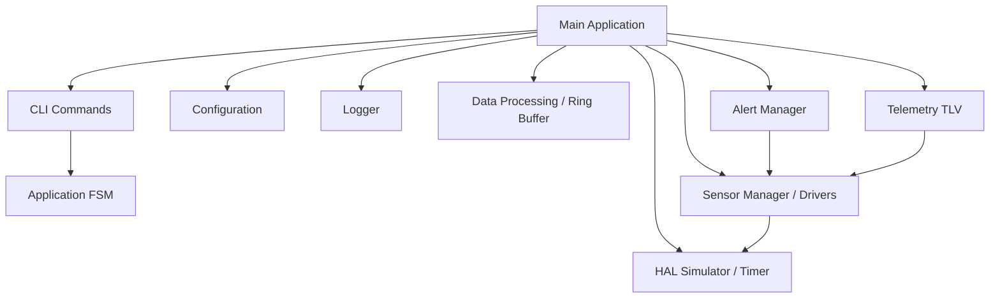
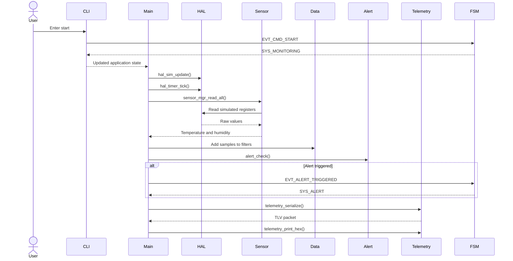
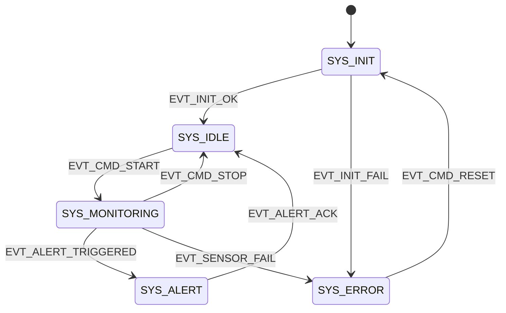

# IoT Environmental Monitoring System — Architecture

## 1. System Overview

The IoT Environmental Monitoring System is a modular application written in C11. It simulates temperature and humidity sensors, processes sensor data, checks alert thresholds, serializes telemetry packets, and provides a command-line interface.

The project uses CMake, Unity, clang-tidy, cppcheck, and GitHub Actions.

## 2. Use Case Diagram



## 3. Component Diagram



## 4. Sequence Diagram

The following diagram describes one monitoring sample after the user enters a CLI command while the system is monitoring.



## 5. State Machine Diagram



The state diagram presents the principal transitions. The full FSM transition table is implemented in `components/app/src/app_fsm.c`.

## 6. Module Responsibilities

| Module | Responsibility |
|---|---|
| Common | Shared types, status codes, design-by-contract macros |
| HAL | Simulated hardware registers and timer ticks |
| Logger | Diagnostic messages and file logging |
| Drivers | Temperature/humidity drivers and sensor manager |
| Data | Ring buffer, moving-average processing, event log |
| Telemetry | TLV serialization and hexadecimal output |
| Alert | Threshold checking and alert acknowledgement |
| App | Finite-state machine and CLI command dispatch |
| Config | Load/save alert thresholds through POSIX file I/O |
| Main | Initialization, integration, monitoring cycle and shutdown |

## 7. Advanced C Concepts

| Concept | Project application |
|---|---|
| Modular programming | Separate components with public headers |
| Pointers | Sensor output parameters, context pointers |
| Function pointers | CLI command dispatch table |
| Structures and enums | Sensor data, configuration, FSM states |
| Static storage | HAL simulation state |
| Bitwise operations | Hardware registers and telemetry encoding |
| Data structures | Ring buffer and event log |
| Design by Contract | REQUIRE, ENSURE, INVARIANT macros |
| File I/O | Logger and configuration persistence |
| State machines | System control and alert handling |
| Unit testing | Unity test executables |
| Static analysis | clang-tidy and cppcheck |
| Memory safety | AddressSanitizer and UndefinedBehaviorSanitizer |

## 8. Build and Test

```bash
cmake -S . -B build -G Ninja
cmake --build build
ctest --test-dir build --output-on-failure
cmake --build build --target cppcheck
```

The project is tested using Unity and checked through automated GitHub Actions workflows.

## 9. Implementation Notes

The application currently uses a CLI-driven monitoring loop. Sensor sampling occurs after a CLI command when the application state is `SYS_MONITORING`; it is not an independent periodic background sampling loop.

Configuration defaults are used when the configuration file is missing.
